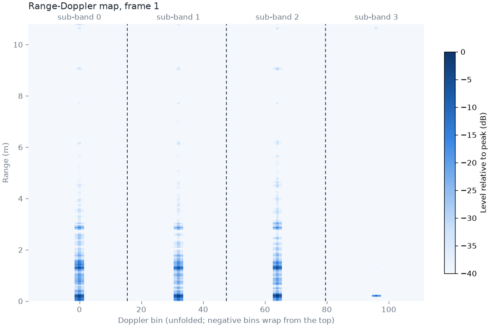

# DDM-MIMO firmware for the AWR1843AOP

Firmware for the Texas Instruments AWR1843AOPEVM 77 GHz radar that uses Doppler-division
multiplexing (DDM) MIMO instead of TI's time-division (TDM) MIMO. It is a modified copy of the
out-of-box demo in TI mmWave SDK 03.06.02 (`xwr18xx_mmw`, AOP variant) and keeps that demo's
command-line interface and UART output format, so existing configuration files and parsers
still work. Without the new `ddmCfg` command the firmware behaves like the stock demo.

## What DDM changes

A MIMO radar forms a *virtual array* of TX × RX antenna pairs (here 3 × 4 = 12) to estimate
angle of arrival (AoA). To do that it must tell the transmitters apart.

- **TDM** (stock TI demo): one TX per chirp, cycling TX0 → TX1 → TX2. Each TX is sampled only
  every third chirp, which limits the unambiguous velocity to about ±6.9 m/s with the stock
  AOP chirp profile.
- **DDM** (this firmware): all three TX transmit on every chirp. TX *k* adds a phase step to
  each chirp, which shifts its copy of every target by *k* Doppler sub-bands. The 128-point
  Doppler FFT is split into 4 sub-bands of 32 bins; three hold the TX copies and one stays empty.
  The empty sub-band tells the processing which copy came from which TX, which recovers the
  12-element virtual array and resolves velocity over the full chirp rate: about ±20.6 m/s
  with 0.32 m/s resolution on the same chirp profile.



*Live range-Doppler map from `ddm heatmap`. Each static target appears once per TX at the
same range, one sub-band apart; sub-band 3 is empty.*

On static targets, angles measured with DDM match the stock TDM firmware within one angle bin,
and the empty sub-band is 31–35 dB below the TX copies.

## Quick start

### 1. Prerequisites

- Ubuntu x86-64 (tested on 26.04) and an AWR1843AOPEVM connected over USB.
- TI tools installed under `~/ti`: [mmWave SDK 03.06.02](https://www.ti.com/tool/MMWAVE-SDK)
  (installs the compilers, SYS/BIOS, XDCtools, DSPLIB and MATHLIB it needs) and
  [UniFlash 9.7](https://www.ti.com/tool/UNIFLASH) in `~/ti/uniflash_9.7.0`.
- System packages, serial port access and [uv](https://docs.astral.sh/uv/):

  ```sh
  sudo dpkg --add-architecture i386
  sudo apt update
  sudo apt install libc6:i386 libstdc++6:i386 make mono-runtime gcc
  sudo usermod -aG dialout $USER     # then log out and back in
  ```

- A udev rule so ModemManager leaves the board's USB-UART bridge (CP2105) alone:

  ```sh
  echo 'ATTRS{idVendor}=="10c4", ATTRS{idProduct}=="ea70", ENV{ID_MM_DEVICE_IGNORE}="1"' \
    | sudo tee /etc/udev/rules.d/71-mm-ignore-cp2105.rules
  sudo udevadm control --reload-rules
  ```

- The repository tracks only the SDK directories it modifies. Fill in the rest of `sdk/` from
  your SDK install, then restore the modified files:

  ```sh
  cp -r ~/ti/mmwave_sdk_03_06_02_00-LTS/firmware ~/ti/mmwave_sdk_03_06_02_00-LTS/packages sdk/
  git checkout -- sdk
  ```

Details and alternatives: [docs/development.md](docs/development.md#environment).

### 2. Build

```sh
./build.sh          # -> out/xwr18xx_mmw_aop_demo.bin
```

### 3. Flash

Set the SOP switches to flashing mode (SOP0 on, SOP1 off, SOP2 on), unplug and replug USB, then:

```sh
./flash.sh
```

Set the switches back to normal mode (SOP0 on, SOP1 off, SOP2 off) and replug USB again.
See [flashing](docs/development.md#flashing) if it fails.

### 4. Check the profile

The host tools are one command, `ddm`, installed into the project environment by uv. Start
with the shipped profile:

```sh
uv run ddm cfg profiles/template.toml
```

This checks the profile against the hardware limits and prints its range and velocity
resolution, maximum velocity and the TI `.cfg` text it sends.

### 5. Capture and decode raw data

With the radar on a [DCA1000EVM](https://www.ti.com/tool/DCA1000EVM) capture card (see
[raw data capture](docs/development.md#raw-data-capture) for its setup):

```sh
uv run ddm capture profiles/template.toml -n 50 -o wave.npz   # 50 frames of ADC samples
uv run ddm decode wave.npz                                    # targets and range-Doppler map
uv run ddm live profiles/template.toml                        # live view; close the window to stop
```

Without `-o`, captures are saved as `captures/YYYYmmdd-HHMMSS_<profile>.npz`.

### 6. Learn to work with the data

[docs/raw_data.ipynb](docs/raw_data.ipynb) walks through DDM decoding step by step in plain
numpy: range and Doppler FFTs, the TX copies in the sub-bands, velocity, the virtual array and
angle. It runs on a capture or on simulated data:

```sh
uv run jupyter lab docs/raw_data.ipynb
```

## On-chip outputs (firmware check)

The firmware also detects targets itself and sends them over the UART data port
(`/dev/ttyUSB1`); no capture card is needed:

```sh
uv run ddm points profiles/template.toml --frames 20   # point cloud summary per frame
uv run ddm heatmap profiles/template.toml              # live range-Doppler map shown above
uv run ddm bands profiles/template.toml                # level per sub-band (static scene)
```

## Host tools

All host tools are subcommands of `ddm`; `uv run ddm COMMAND --help` lists the options.

| Command | Purpose |
|---|---|
| `ddm cfg PROFILE [-o FILE]` | Check a profile against the hardware limits, show its derived numbers, write the `.cfg` |
| `ddm points PROFILE` | Configure the radar and print a point-cloud summary per frame |
| `ddm heatmap PROFILE` | Live range-Doppler heat map with the sub-bands marked |
| `ddm bands PROFILE` | Level of each Doppler sub-band at the strongest target (static scene) |
| `ddm capture PROFILE` | Record raw ADC frames through a DCA1000EVM |
| `ddm decode CAPTURE.npz` | Decode a raw capture: range-Doppler map and the strongest targets |
| `ddm live PROFILE` | Live raw-data view: range-Doppler, decoded range-velocity and top view |

Every command takes `-v` for debug output (each command sent to the radar, tracebacks) or `-q`
for warnings and errors only, after the command name: `uv run ddm points -v PROFILE`. `--cli` and `--data` select other serial ports.

### Profiles

A `PROFILE` is a short TOML file or a TI `.cfg` file. `profiles/template.toml` is the one
shipped profile: every radar setting with its unit, limit and the formulas for maximum velocity
and velocity resolution. Each command adds the outputs it needs (point cloud, heat map or raw
ADC data), so one profile serves all of them. Stock TI configuration files such as
`sdk/packages/ti/demo/xwr18xx/mmw/profiles/profile_3d_aop.cfg` still work and are sent as they
are.

To change velocity range or resolution, copy the template, edit it, check it, then run it. Every
command sends the profile to the radar itself; there is no separate load step.

```sh
cp profiles/template.toml profiles/mine.toml     # edit the RADAR section
uv run ddm cfg profiles/mine.toml                # limits, range/velocity resolution, .cfg text
uv run ddm cfg profiles/mine.toml --for points   # the .cfg that ddm points would send
uv run ddm capture profiles/mine.toml            # or live, points, heatmap
```

DDM is the default (`[mimo] bands = 4`); set `tdm = true` in `[mimo]` for TI's time-division
MIMO with one TX per chirp. The tools read the mode from the configuration. See
[profiles](docs/configuration.md#profiles) for every key and the hardware limits.

## Documentation

| Page | Contents |
|---|---|
| [docs/raw_data.ipynb](docs/raw_data.ipynb) | Hands-on guide to raw DDM data: FFTs, sub-bands, velocity, virtual array and angle |
| [docs/architecture.md](docs/architecture.md) | How DDM works in detail, the MSS/DSS processing chain, buffer layouts, and where each DDM step lives in the code |
| [docs/configuration.md](docs/configuration.md) | The `ddmCfg` command, rules for DDM chirp configurations, the TOML profile format, a worked example, and unsupported options |
| [docs/development.md](docs/development.md) | Repository layout, toolchain, build variants, flashing details, tests, linting, coding conventions, and how to extend the firmware |

## Limitations

- A target that falls between two Doppler bins can be reported one bin (0.32 m/s) off.
- One target per range/Doppler cell is assumed. Two targets at the same range whose sub-band
  copies overlap can be given the wrong velocity.
- Signals that do not carry the TX phase code, such as receiver spurs near maximum range,
  are resolved to a wrong velocity.
- Very strong returns leak about 17 dB into the empty sub-band.
- On the AWR1843AOP the IF signal carries the negative of the programmed TX phase, so the
  firmware programs a decreasing phase ramp. Other devices may behave differently.
- Range-bias/RX-phase measurement, static clutter removal, DC range calibration and the
  range-azimuth heat map are not available in DDM mode. See
  [configuration](docs/configuration.md#unsupported-options).

## License

The code written for this project is released under the [MIT License](LICENSE); those files
carry an `SPDX-License-Identifier: MIT` line. The files under `sdk/` that come from the TI
mmWave SDK, including the ones modified here, remain © Texas Instruments under the terms stated
in their file headers (a BSD-style license that requires the copyright notice to be kept in
source and binary redistributions).
