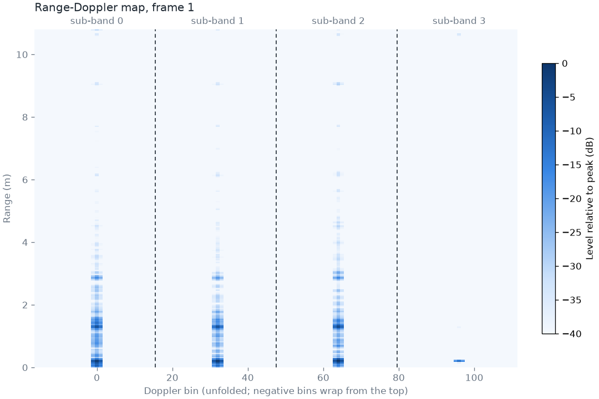

# DDM-MIMO firmware for the AWR1843AOP

Firmware for the Texas Instruments AWR1843AOPEVM 77 GHz radar that uses Doppler-division
multiplexing (DDM) MIMO instead of TI's time-division (TDM) MIMO. It is a modified copy of the
out-of-box demo in TI mmWave SDK 03.06.02 (`xwr18xx_mmw`, AOP variant) and keeps that demo's
command-line interface and UART output format, so existing configuration files and parsers
still work. Without the new `ddmCfg` command the firmware behaves like the stock demo.

## What DDM changes

A MIMO radar forms a *virtual array* of TX × RX antenna pairs (here 3 × 4 = 12) to estimate
angle of arrival (AoA). To do that it must tell the transmitters apart.

- **TDM** (stock TI demo): one TX per chirp, cycling TX0 → TX1 → TX2. Each TX is sampled only
  every third chirp, which limits the unambiguous velocity to about ±6.9 m/s with the stock
  AOP chirp profile.
- **DDM** (this firmware): all three TX transmit on every chirp. TX *k* adds a phase step to
  each chirp, which shifts its copy of every target by *k* Doppler sub-bands. The 128-point
  Doppler FFT is split into 4 sub-bands of 32 bins; three hold the TX copies and one stays empty.
  The empty sub-band tells the processing which copy came from which TX, which recovers the
  12-element virtual array and resolves velocity over the full chirp rate: about ±20.6 m/s
  with 0.32 m/s resolution on the same chirp profile.



*Live range-Doppler map from `host/rd_view.py`. Each static target appears once per TX at the
same range, one sub-band apart; sub-band 3 is empty.*

On static targets, angles measured with DDM match the stock TDM firmware within one angle bin,
and the empty sub-band is 31–35 dB below the TX copies.

## Quick start

### 1. Prerequisites

- Ubuntu x86-64 (tested on 26.04) and an AWR1843AOPEVM connected over USB.
- TI tools installed under `~/ti`: [mmWave SDK 03.06.02](https://www.ti.com/tool/MMWAVE-SDK)
  (installs the compilers, SYS/BIOS, XDCtools, DSPLIB and MATHLIB it needs) and
  [UniFlash 9.7](https://www.ti.com/tool/UNIFLASH) in `~/ti/uniflash_9.7.0`.
- System packages, serial port access and [uv](https://docs.astral.sh/uv/):

  ```sh
  sudo dpkg --add-architecture i386
  sudo apt update
  sudo apt install libc6:i386 libstdc++6:i386 make mono-runtime gcc
  sudo usermod -aG dialout $USER     # then log out and back in
  ```

- A udev rule so ModemManager leaves the board's USB-UART bridge (CP2105) alone:

  ```sh
  echo 'ATTRS{idVendor}=="10c4", ATTRS{idProduct}=="ea70", ENV{ID_MM_DEVICE_IGNORE}="1"' \
    | sudo tee /etc/udev/rules.d/71-mm-ignore-cp2105.rules
  sudo udevadm control --reload-rules
  ```

- The repository tracks only the SDK directories it modifies. Fill in the rest of `sdk/` from
  your SDK install, then restore the modified files:

  ```sh
  cp -r ~/ti/mmwave_sdk_03_06_02_00-LTS/firmware ~/ti/mmwave_sdk_03_06_02_00-LTS/packages sdk/
  git checkout -- sdk
  ```

Details and alternatives: [docs/development.md](docs/development.md#environment).

### 2. Build

```sh
./build.sh          # -> out/xwr18xx_mmw_aop_demo.bin
```

### 3. Flash

Set the SOP switches to flashing mode (SOP0 on, SOP1 off, SOP2 on), unplug and replug USB, then:

```sh
./flash.sh
```

Set the switches back to normal mode (SOP0 on, SOP1 off, SOP2 off) and replug USB again.
See [flashing](docs/development.md#flashing) if it fails.

### 4. Run

```sh
uv run python host/mmw_host.py host/profiles/ddm_aop.cfg --frames 20
```

This sends the configuration on `/dev/ttyUSB0` and prints one line per frame from
`/dev/ttyUSB1`: frame number, number of detected points, and the nearest point's position (m)
and radial velocity (m/s).

### 5. See the sub-bands

```sh
uv run python host/rd_view.py host/profiles/ddm_aop_rdmap.cfg
```

This opens the live range-Doppler map shown above (close the window to stop the radar).

## Documentation

| Page | Contents |
|---|---|
| [docs/architecture.md](docs/architecture.md) | How DDM works in detail, the MSS/DSS processing chain, buffer layouts, and where each DDM step lives in the code |
| [docs/configuration.md](docs/configuration.md) | The `ddmCfg` command, rules for DDM chirp configurations, a worked example, and unsupported options |
| [docs/development.md](docs/development.md) | Repository layout, toolchain, build variants, flashing details, tests, linting, coding conventions, and how to extend the firmware |

## Limitations

- A target that falls between two Doppler bins can be reported one bin (0.32 m/s) off.
- One target per range/Doppler cell is assumed. Two targets at the same range whose sub-band
  copies overlap can be given the wrong velocity.
- Signals that do not carry the TX phase code, such as receiver spurs near maximum range,
  are resolved to a wrong velocity.
- Very strong returns leak about 17 dB into the empty sub-band.
- On the AWR1843AOP the IF signal carries the negative of the programmed TX phase, so the
  firmware programs a decreasing phase ramp. Other devices may behave differently.
- Range-bias/RX-phase measurement, static clutter removal, DC range calibration and the
  range-azimuth heat map are not available in DDM mode. See
  [configuration](docs/configuration.md#unsupported-options).

## License

The code written for this project is released under the [MIT License](LICENSE); those files
carry an `SPDX-License-Identifier: MIT` line. The files under `sdk/` that come from the TI
mmWave SDK, including the ones modified here, remain © Texas Instruments under the terms stated
in their file headers (a BSD-style license that requires the copyright notice to be kept in
source and binary redistributions).
