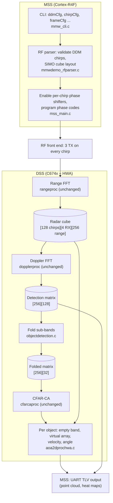

# Architecture

This page explains how DDM-MIMO is implemented on top of TI's `xwr18xx_mmw` demo: the signal
model, the processing chain on each core, the buffer layouts, and where each step lives in the
source. Paths are relative to `sdk/packages/ti/`.

## Terms

| Term | Meaning |
|---|---|
| TDM-MIMO | Time-division multiplexing: one TX antenna per chirp, TX antennas take turns. TI's stock demo. |
| DDM-MIMO | Doppler-division multiplexing: all TX antennas on every chirp, separated by a per-chirp phase code that shifts each TX in the Doppler spectrum. |
| SIMO | Single input, multiple output: a radar cube with one TX block and one channel per RX antenna. The DDM radar cube has this layout. |
| Virtual array | The TX × RX antenna pairs used for angle estimation. 3 TX × 4 RX = 12 elements, indexed `tx * 4 + rx`. |
| CFAR | Constant false alarm rate detection: finds cells above a locally estimated noise floor in the range-Doppler detection matrix. Runs on the hardware accelerator (`cfarcaproc`). |
| AoA | Angle of arrival: azimuth/elevation estimation from the virtual array (`aoa2dproc`). |
| MSS | Master subsystem, ARM Cortex-R4F: command line, RF configuration, UART output. |
| DSS | DSP subsystem, C674x DSP: signal processing chain, using the FFT hardware accelerator (HWA) and EDMA. |
| BSS | Radar subsystem that runs the RF front end. Configured from the MSS through mmWaveLink (`rl*` calls). |

## Signal model

The AWR1843 has a 6-bit phase shifter per TX (64 steps of 5.625°) that can be programmed per
chirp. With `ddmCfg N` (N sub-bands), the firmware programs TX *k* on chirp *n* of each loop to

    programmed phase = −n · k · 360° / N

On this device the IF signal carries the negative of the programmed phase, so in the received
data TX *k* advances by +*k* · 360°/N per chirp. A constant phase step per chirp is a frequency
shift in slow time: TX *k*'s copy of a target appears *k* · (Doppler bins / N) bins above the
TX0 copy, modulo the spectrum width. With N > number of TX, at least one sub-band contains no
copy.

The pattern repeats every N chirps, so it is set once with N static chirp definitions
(`chirpCfg 0..N-1`) looped by `frameCfg`; nothing changes at run time. N must divide 64 so that
the phase step is a whole number of phase shifter steps.

With the shipped profile (`host/profiles/ddm_aop.cfg`, N = 4, 32 loops):

| | TDM (stock `profile_3d_aop.cfg`) | DDM (`ddm_aop.cfg`) |
|---|---|---|
| TX per chirp | 1 | 3 |
| Chirps per frame | 96 (3 × 32) | 128 (4 × 32) |
| Doppler FFT | 32 bins per TX | 128 bins, 4 sub-bands of 32 |
| Max unambiguous velocity | ±6.9 m/s | ±20.6 m/s |
| Velocity resolution | 0.43 m/s | 0.32 m/s |
| Chirps per TX per frame | 32 | 128 |
| Motion phase between TX copies | compensated in AoA | none (TX simultaneous) |
| Virtual array | 12 (3 TX × 4 RX) | 12, same geometry |
| Radar cube | 384 KB | 512 KB |

Both use a 46 µs chirp period (7 µs idle + 39 µs ramp), 77 GHz start frequency, 100 MHz/µs
slope and 256 ADC samples (0.042 m range bins).

Velocity follows from the RF parser's `dopplerStep = c / (2 · fc · numDopplerBins · numTxAntennas · Tc)`.
With DDM the cube has one TX block (`numTxAntennas = 1`) and 128 Doppler bins, so velocity is
resolved over the full chirp rate.

## Processing chain

| Stage | Core | Source | DDM behaviour |
|---|---|---|---|
| Command line | MSS | `demo/xwr18xx/mmw/mss/mmw_cli.c` | New `ddmCfg <numBands>` command; `sensorStop` clears it |
| Chirp config parsing | MSS | `demo/utils/mmwdemo_rfparser.c` | Validates DDM chirps; describes the radar cube as one TX block |
| Data path config | MSS | `demo/xwr18xx/mmw/mss/mss_main.c` | Rejects options that assume one TX per chirp; passes `ddmNumBands`/`ddmNumTx` to the DSS |
| RF setup | MSS | `demo/xwr18xx/mmw/mss/mss_main.c` | Enables the per-chirp phase shifters and programs the phase codes |
| Range FFT | DSS | `datapath/dpu/rangeproc` | Unchanged |
| Doppler FFT | DSS | `datapath/dpc/dpu/dopplerproc` | Unchanged; produces the full 128-bin detection matrix |
| Sub-band fold | DSS | `datapath/dpc/objectdetection/objdethwa/src/objectdetection.c` | Averages the sub-bands into the CFAR input matrix |
| Detection (CFAR) | DSS | `datapath/dpc/dpu/cfarcaproc` | Unchanged; configured for the folded size |
| Angle of arrival | DSS | `datapath/dpc/dpu/aoa2dproc/src/aoa2dprochwa.c` | Per object: finds the empty sub-band, builds the virtual array, sets the velocity bin; skips TDM motion compensation |
| Output | MSS | `demo/xwr18xx/mmw/mss/mss_main.c` | Unchanged format |

### MSS: configuration

1. `ddmCfg N` stores N in `gMmwMssMCB.ddmNumBands` (`mmw_cli.c`). It is refused while the
   sensor is running, and `sensorStop` resets it to 0 because `flushCfg` is handled inside TI's
   CLI library and cannot clear it.
2. `MmwDemo_dataPathConfig()` (`mss_main.c`) copies N into the RF parser input. With N ≠ 0,
   `MmwDemo_RFParser_setDdmParams()` (`mmwdemo_rfparser.c`) replaces TI's TDM antenna
   parsing. It checks that every chirp enables the same contiguous TX set starting at TX0, with
   at least 2 and fewer than N TX. It then reports a SIMO cube: `numTxAntennas = 1`,
   `numVirtualAntennas = numRxAntennas`, and `ddmNumTx` = the real TX count. It also sets
   `validProfileHasOneTxPerChirp = 1`, because to the rest of the AOP chain the cube looks like
   a single-TX profile.
3. `MmwDemo_dataPathConfig()` rejects range-bias/RX-phase measurement, static clutter removal
   DC range calibration and the range-azimuth heat map when DDM is active, and fills `ddmNumBands` and `ddmNumTx` in the
   DSS static configuration. `txAntOrder` is copied for `ddmNumTx` entries so AoA sees all TX.
4. `MmwDemo_configSensor()` (`mss_main.c`):
   - Before `MMWave_config()`, `MmwDemo_ddmSetPhaseShifter()` calls `rlRfSetMiscConfig()`
     to enable the per-chirp phase shifters (`miscCtl` bit 0). This is only sent if DDM is
     on, or was on in the previous configuration (to turn it off again), so TDM configurations
     send exactly TI's command sequence.
   - After `MMWave_config()`, `MmwDemo_ddmConfigPhaseShift()` checks for a legacy frame
     (`dfeDataOutputMode 1`) with exactly N chirps per loop and calls
     `rlRfSetPhaseShiftConfig()` with one entry per chirp. TX0 is never phase-shifted;
     `MmwDemo_ddmPhaseShift()` computes the TX1/TX2 values (6-bit phase in bits 7:2).

### DSS: per frame

1. **Range FFT** (`rangeproc`, unchanged) writes the radar cube. With one TX block the cube
   holds every chirp as consecutive Doppler samples.
2. **Doppler FFT** (`dopplerproc`, unchanged) runs a 128-point FFT per range bin and RX and
   writes the 256 × 128 detection matrix. This full matrix is also the source of the
   range-Doppler heat map sent to the host, so the host sees all sub-bands.
3. **Fold** (`DPC_ObjectDetection_execute()` in `objectdetection.c`) calls
   `DPIF_ddmFoldDetMatrix()` on the DSP: for each range bin and each bin *b* in 0..31, the
   output is the mean of the four input values at *b*, *b*+32, *b*+64 and *b*+96. Values are
   log2 magnitudes, so the mean keeps the Q8 format and adds the energy of the TX copies.
   The CFAR accelerator needs its whole input matrix in 32 KB; the 64 KB unfolded matrix does
   not fit, the 16 KB folded one does (the same size as stock TDM's 256 × 32).
4. **CFAR** (`cfarcaproc`, unchanged) runs on the folded matrix. `DPC_ObjDet_CFARCAconfig()`
   is given `log2NumDopplerBins − log2(N)` and the folded buffer. Each detection carries a
   range bin and a *folded* Doppler bin (0..31), whose velocity is still ambiguous.
5. **AoA** (`aoa2dprochwa.c`), per detected object:
   1. The HWA recomputes the Doppler FFT for the object's range bin from the radar cube.
   2. An EDMA transfer gathers the 4 RX samples at the folded bin from each of the N
      sub-bands (`bCount = N`, source stride of one sub-band), giving `[band][rx]`.
   3. `AoAProcHWA_ddmVirtualArray()` computes the power in each sub-band and calls
      `DPIF_ddmTx0Band()`, which takes the first band of the strongest run of consecutive
      bands (one per TX) as TX0's band. It reorders the samples to virtual-array order `[tx][rx]` using
      `DPIF_ddmTxBand()`, and replaces the object's Doppler index with TX0's unfolded bin from
      `DPIF_ddmTxDopplerBin()`.
   4. RX channel gain/phase compensation (`compRangeBiasAndRxChanPhase`) is applied as in TDM.
   5. TDM Doppler (motion) compensation between TX is skipped, because all TX transmit on the
      same chirp.
   6. Angle FFTs and point generation are unchanged. Velocity is `dopplerStep` × the signed
      unfolded bin.

The point cloud TLV therefore reports velocity over the full ±20.6 m/s range.

## Buffer layouts

| Buffer | Location | Layout (DDM, shipped profile) | Size |
|---|---|---|---|
| Radar cube | L3 | `cmplx16ImRe_t x[1][128][4][256]` (`DPIF_RADARCUBE_FORMAT_1`: TX block, chirp, RX, range) | 512 KB |
| Detection matrix | L3 | `uint16_t x[256][128]`, log2 magnitude in Q8 (`DPIF_DETMATRIX_FORMAT_1`) | 64 KB |
| Folded detection matrix | L3 | `uint16_t x[256][32]`, same format; allocated only with DDM | 16 KB |
| AoA per-object input | DSS local RAM | `cmplx16ImRe_t x[N][4]` as gathered, reordered in place to `x[3][4]` = virtual element `tx * 4 + rx` | 64 bytes |

In TDM the radar cube is `x[3][32][4][256]` and the CFAR reads the detection matrix directly.

The AoA DPU uses two macros to describe the cube: `AOAHWA_NUM_CUBE_TX()` (1 with DDM,
otherwise the TX count) for EDMA and HWA parameter sets that walk the cube, and
`numTxAntennas` (3 with DDM) for everything that works on the virtual array.

## Shared DDM helpers: `datapath/dpif/dpif_ddm.h`

The sub-band arithmetic is in one header of `static inline` functions with no hardware
dependencies. The DSS firmware and the host test `test/ddm_test.c` include the same file.

| Function / macro | Purpose | Used by |
|---|---|---|
| `DPIF_DDM_MAX_BANDS` | Largest supported N (16) | CLI validation, AoA buffer sizing |
| `DPIF_ddmFoldDetMatrix()` | Averages N sub-bands of a range-major detection matrix into one; N must be a power of 2 | `objectdetection.c` |
| `DPIF_ddmTx0Band()` | Returns the first band of the strongest run of `numTx` consecutive bands, i.e. TX0's band | `aoa2dprochwa.c` |
| `DPIF_ddmTxBand()` | Band of TX *k* given TX0's band | `aoa2dprochwa.c` |
| `DPIF_ddmTxDopplerBin()` | Unfolded Doppler bin of TX *k*'s copy | `aoa2dprochwa.c` |

## Changed files

Paths are under `sdk/packages/ti/`. Apart from these, the only modified SDK file is
`sdk/packages/scripts/unix/setenv.sh` (build environment, see
[development.md](development.md#environment)).

| File | Change |
|---|---|
| `datapath/dpif/dpif_ddm.h` | New: DDM helpers |
| `demo/xwr18xx/mmw/mss/mmw_cli.c` | `ddmCfg` command; `sensorStop` clears it; `sensorStart` prints the failing step and error code |
| `demo/xwr18xx/mmw/mss/mmw_mss.h` | `ddmNumBands`, `isDdmPhaseShifterEnabled` in the MSS control block; `MMWDEMO_DDM_PHASE_STEPS` |
| `demo/xwr18xx/mmw/mss/mss_main.c` | Phase shifter enable and phase codes; DDM option checks; DDM fields in the DSS configuration |
| `demo/utils/mmwdemo_rfparser.{c,h}` | `MmwDemo_RFParser_setDdmParams()`; `ddmNumBands` input and `ddmNumTx` output |
| `datapath/dpc/objectdetection/objdethwa/objectdetection.h` | `ddmNumBands`, `ddmNumTx` in the static configuration |
| `datapath/dpc/objectdetection/objdethwa/src/objectdetection.c` | Folded CFAR matrix allocation and fold; virtual TX count for AoA, antenna geometry and RX phase compensation |
| `datapath/dpc/dpu/aoa2dproc/aoa2dprochwa.h` | `ddmNumBands` in the AoA static configuration |
| `datapath/dpc/dpu/aoa2dproc/src/aoa2dprochwa.c` | SIMO cube handling, per-band EDMA gather, `AoAProcHWA_ddmVirtualArray()`, no TDM motion compensation, DDM parameter checks |

The DDM path exists only in the 2D AoA DPU (`aoa2dproc`) used by the AOP build. The non-AOP
build uses a different AoA DPU, and `sensorStart` fails if `ddmCfg` is set (see
[development.md](development.md#build-variants)).

To see every line changed against TI's sources, see
[development.md](development.md#comparing-with-tis-sdk).
